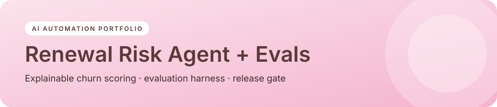

<p align="center"></p>

<p align="center">


<a href="https://sider.ai/agents/web-creator/share/695ea81100a621619985fdfb"></a>
</p>

<p align="center"><a href="https://naekitakadoportfolio.github.io/renewal-risk-agent-evals/"></a></p>

# Renewal Risk Agent + Evaluation Harness

Flags customer accounts at risk of churning before renewal, explains **why** (risk drivers), and recommends a **next-best action**. The repo also includes an **evaluation harness** that checks the scorer against a labeled dataset before any change ships.

> Fictional data. Portfolio demo by Nae Kitakado.

## Why it matters
Customer Success teams often find churn risk too late. A transparent score with clear drivers lets managers act early and trust the output, and the eval harness keeps the logic from quietly drifting.

## What it demonstrates
| Skill | Where |
|---|---|
| Auditable risk scoring (weighted signals, explainable drivers) | `src/scorer.py` |
| Next-best-action recommendations | `next_best_action()` |
| Evaluation harness: accuracy, confusion matrix, misses, release threshold | `src/evaluate.py` |
| CI-style gate (exit code fails the build if accuracy < 80%) | `evaluate.py` |
| Tests | `tests/test_evals.py` |

## Run it
```bash
python src/evaluate.py
pytest -q
```

## Extending it
Feed live signals from the CRM, support desk and product usage, and use an LLM to draft the exec-review summary while the rules stay the source of truth for the score.

---
<p align="center"><sub>Built by <b>Nae Kitakado</b>, AI Automation Consultant · <a href="https://www.linkedin.com/in/nae-k-203194265">LinkedIn</a> · <a href="https://sider.ai/agents/web-creator/share/695ea81100a621619985fdfb">Portfolio</a> · open to retainer &amp; part-time consulting</sub></p>
